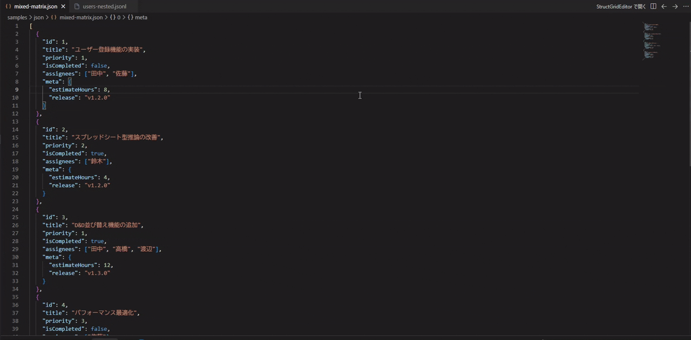

# StructGridEditor

JSON, JSONL, YAML, CSV, TSV 形式の構造化データをスプレッドシート形式で閲覧・編集でき、さらに Markdown ドキュメント（`.md`, `.markdown`）を Live Preview / WYSIWYG 形式で見たまま編集できる VS Code 拡張機能です。 任意の階層にネストされた構造化データや表データ、技術文書を、元の書式を損なうことなく直感的に編集できます。

---

## 主な機能と仕様

### 1\. 対応フォーマット

- **JSON**: `*.json`（スプレッドシート / ツリー表示）
- **JSONL**: `*.jsonl`（スプレッドシート表示）
- **YAML**: `*.yaml`, `*.yml`（スプレッドシート / ツリー表示）
- **CSV**: `*.csv`（スプレッドシート表示、ヘッダー行あり / なし切り替え対応）
- **TSV**: `*.tsv`（スプレッドシート表示、ヘッダー行あり / なし切り替え対応）
- **Apache Parquet**: `*.parquet`（スプレッドシート表示、読み取り専用 / Read-Only）
- **Apache Avro**: `*.avro`（スプレッドシート表示、読み取り専用 / Read-Only）
- **Markdown**: `*.md`, `*.markdown`（Live Preview / WYSIWYG 表示）

### 2\. 起動方法とデフォルトエディタ設定

- **デフォルトでカスタムビューが起動する拡張子（初期設定）**:
    - **Markdown (**`.md`**,** `.markdown`**)**: ファイルを開くと標準で **Markdown Live Preview Editor** が起動します。右上の **「ソース表示」** ボタンでいつでも標準テキストエディタと切り替えられます。
    - **JSONL (**`.jsonl`**) / CSV (**`.csv`**) / TSV (**`.tsv`**)**: ファイルを開くと標準で **StructGridEditor** が起動します。
- **右クリックメニューから起動する拡張子（初期設定）**:
    - **JSON (**`.json`**) / YAML (**`.yaml`**,** `.yml`**)**: エクスプローラーまたはエディタータブの右クリックメニューから **「StructGridEditor で開く」** を選択するとグリッドビューで開きます（右上の **「テキストで開く」** ボタンで通常のテキストエディタへ戻れます）。
- **拡張子ごとのデフォルト起動 ON / OFF 設定**:
    - VS Code の設定画面（`StructGridEditor`）にある以下のチェックボックスで、拡張子ごとにシングルクリックでカスタムエディタを起動するかどうかをいつでも変更できます。
        - `struct-grid-editor.openByDefault.markdown`（初期値: `true`）
        - `struct-grid-editor.openByDefault.jsonl`（初期値: `true`）
        - `struct-grid-editor.openByDefault.csv`（初期値: `true`）
        - `struct-grid-editor.openByDefault.tsv`（初期値: `true`）
        - `struct-grid-editor.openByDefault.json`（初期値: `false`）
        - `struct-grid-editor.openByDefault.yaml`（初期値: `false`）
    - ※ Markdown Live Preview エディタで編集・保存した際は、標準の GFM / Admonition / 4スペースインデントリスト形式に正規化されます（`` 等の生 HTML タグ属性や HTML コメントをそのまま維持したいファイルは「ソース表示」で標準テキストエディタに切り替えて編集してください）。

---

## Markdown Live Preview エディタの仕様

### 1\. カーソル連動型ライブプレビュー (Live Preview)

- 通常時は見出し・太字・斜体・取り消し線・インラインコード・リンク・引用がレンダリングされた状態で表示されます。
- カーソルが当たっている行や装飾箇所のみ `#` 、`##` 、`**太字**`、`*斜体*`、`[テキスト](URL)` などの Markdown 記法マーカーが動的に展開され、そのまま直接編集できます。
- 行頭やスペースの後に `/` を入力すると **スラッシュコマンドメニュー** が開き、見出し・テーブル・タスクリスト・Admonition・コードブロック・Mermaid 図表・数式ブロックを素早く挿入できます。

### 2\. 技術文書向け拡張記法（Python-Markdown / GFM 互換）

- **Admonition / 折りたたみブロック**: `!!! note "タイトル"` や `??? warning "折りたたみタイトル"`、`???+ info` のボックス表示・ヘッダー編集に対応し、内部コンテンツは 4 スペースインデントで保存されます。
- **YAML Frontmatter**: ファイル先頭の `---` で囲まれたメタデータを専用パネルで分離表示・編集し、水平線への誤変換を防ぎます。
- **GFM テーブル・タスクリスト**: テーブル内にカーソルを置くと行・列の追加や削除を行えるコンテキストバーが表示されます。チェックボックス付きのタスクリスト（`- [ ]` / `- [x]`）や 4 スペースインデントのネストリストにも対応しています。

### 3\. Mermaid 図表 ＆ KaTeX 数式のライブプレビュー

- **Mermaid ダイアグラム**: 言語が `mermaid` のコードブロックは自動的に SVG 図表として描画され、「ソースを編集」ボタン（または図のクリック）でコードを編集するとリアルタイムに図表が更新されます。
- **KaTeX 数式**: インライン数式（`$`）およびブロック数式（\`

$$
...
$$

\`）を描画し、クリックするとポップオーバーで LaTeX 数式を編集できます。

### 4\. Read Mode・Split View・Show Index・画像貼り付け・リンク遷移・テーマ切り替え

- **Read Mode**: 上部ツールバー右側の **「Read Mode」** トグル（初期値: OFF）を ON にすると、編集をロックし、行をクリックしても Markdown 記法マーカー（rawtext）が表示されない閲覧専用状態になります。
- **Split View（左右分割）**: 上部ツールバー右側の **「Split View」** トグル（初期値: OFF）を ON にすると、左側にプレビュー、右側にローテキストの Markdown エディタを表示し、双方向にリアルタイム同期しながら編集できます。
- **Show Index（見出し一覧）**: プレビュー画面右上にドキュメント内の見出し一覧が表示され、クリックで該当見出しへジャンプできます。上部ツールバー右側の **「Show Index」** トグル（初期値: ON）で表示・非表示を切り替えられます。
- 各トグルの設定状態は保存され、別の Markdown ファイルを開いても維持されます。
- **Ctrl + クリック（Mac: Cmd + クリック）によるリンク遷移**:
    - **ローカルファイルリンク**（例: `[ai-development-workflow.md](../.agents/rules/ai-development-workflow.md)`）を `Ctrl + クリック` すると、該当ファイルが存在する場合は新しいエディタタブで開きます（存在しないパスの場合はスキップします）。
    - **外部 Web リンク**（`http://` / `https://`）を `Ctrl + クリック` すると、開いてよいかの確認ダイアログを表示した上で外部ブラウザで開きます。
- **クリップボード画像貼り付け**: エディタ上に画像をペーストまたはドラッグ＆ドロップすると、ワークスペース内の `assets/` フォルダ（設定 `struct-grid-editor.markdownAssetsFolder` で変更可能）へ自動保存され、相対パスリンクとして挿入されます。
- **テーマ切り替え**: VS Code のカラーテーマに自動追従するほか、右上の **「Theme: Dark (Slate) / Light (Default)」** ボタンでいつでもライト・ダーク表示を切り替えられます。

---

## グリッドエディタの仕様（JSON / YAML / JSONL / CSV / TSV）

### 1\. 配列・表データ（トップレベル配列・JSONL・CSV・TSV）: スプレッドシート表示

- `samples/json/simple-list.json`、`samples/jsonl/simple-list.jsonl`、`samples/csv/simple-list.csv`、`samples/tsv/simple-list.tsv` のような表形式・配列データを開いた場合、各カラムを列とし、各レコードを行とする**スプレッドシート形式**で表示されます。
- セル編集、行追加・削除、列追加・列名変更、列の並び替え・非表示・ソートなどの編集ができます。
- **CSV / TSV のヘッダー有無切り替え**:
    - デフォルトでは **1行目をヘッダー（カラム名）** として読み込みます。
    - ヘッダー行がない CSV / TSV（例: `samples/csv/no-header-list.csv`）を開く場合は、画面上部ツールバーの **「1行目をヘッダーにする」** チェックボックスを OFF にすることで、1行目も含めた全行をデータ行（列名は `col1`, `col2`, ...）として表示・編集・保存できます。
    - RFC 4180 に準拠し、カンマやタブ、改行、ダブルクォート（`""`）を含むセルも正確にエスケープ・保持されます。

### 2\. オブジェクトデータ（K,V）: ツリー表示 ＆ 配列ドリルダウン機能

- トップレベルがオブジェクト（キー・バリュー形式）である場合、階層ツリー・パス表示が行われます。
- データ内に配列が存在する場合、初期状態では要素ごとに展開されず、値の列に **「編集する」** ボタンが表示されます。
- クリックすると、該当配列のスプレッドシート（テーブル）画面に切り替わります。

### 3\. セル編集と型推論

- **直接編集**: 値のセルをクリックすることで、その場でテキスト編集が可能です。
- **自動型推論**:
    - `true` / `false` と入力 → `boolean` として保存
    - `123` や `45.67` と入力 → `number` として保存
    - `null` と入力 → `null` として保存
    - その他の文字列 → `string` として保存

### 4\. リアルタイム検索フィルター

- 画面上部の検索ボックスにキーワードを入力すると、**パス名** または **値** に一致する行のみが即座に絞り込み表示されます。

### 5\. 書式保持仕様 (Format Preservation)

- **インデント**: 元ファイルのインデント幅（2スペース、4スペース、タブなど）を自動検知し、編集後も同一スタイルで再シリアライズされます。
- **末尾改行**: 元ファイルに末尾改行が存在するかを検知し、維持します。
- **YAML コメント**: 編集対象外のコメントやドキュメント構造を損なわないよう保持されます。

---

### 6\. キーボード操作（Excel / Google スプレッドシート ライク）

スプレッドシートビューでは、Excel や Google スプレッドシートに近い直感的なキーボード操作が可能です。

| キー操作 | 動作 |
| --- | --- |
| `Enter` / テンキー Enter | 現在セルの値を確定し、**直下の行**の同一列セルへフォーカス移動 |
| `Shift + Enter` | 値を確定し、**直上の行**の同一列セルへフォーカス移動 |
| `Tab` | 現在セルの値を確定し、**右隣**のセルへフォーカス移動（行末で次行先頭へ折り返し） |
| `Shift + Tab` | 値を確定し、**左隣**のセルへフォーカス移動（行頭で前行末尾へ折り返し） |
| `↑` / `↓` / `←` / `→` （矢印キー） | セル選択時に上下左右のセルへ移動 |
| `Alt + Enter` または `Ctrl + Enter` | セル内に**改行**を挿入 |
| `Ctrl + A` （編集中） | 現在編集セル内のテキストを**全選択**（テーブル全選択にはならない） |
| `Ctrl + A` （非編集時） | テーブル全体を選択 |

- セル内に改行コードが含まれる場合、セル内で折り返して複数行表示されます。

---

## 開発者向けドキュメント

アーキテクチャ設計、ビルド・テスト手順、API 仕様書、テスト仕様書については以下を参照してください。

- [開発者ガイド (docs/developer-guide.md)](docs/developer-guide.md "Ctrl+クリック (Mac: Cmd+クリック) でリンク先を開く")
- [テスト仕様書 (docs/test-specifications.md)](docs/test-specifications.md "Ctrl+クリック (Mac: Cmd+クリック) でリンク先を開く")
- [アーキテクチャ意思決定記録 (docs/adr/)](docs/adr/ "Ctrl+クリック (Mac: Cmd+クリック) でリンク先を開く")
