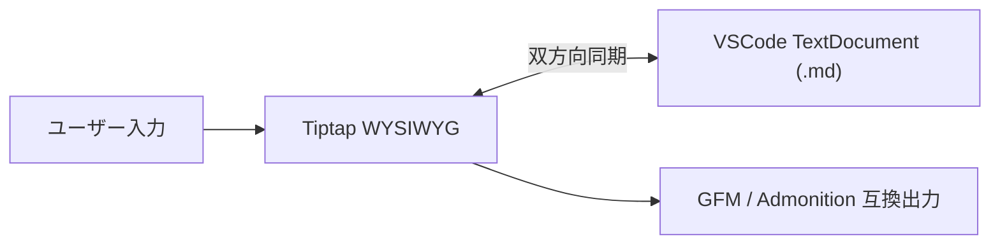

# Markdown Live Preview エディタへようこそ

このファイルは **VSCode Custom Text Editor** 上で動作する見たまま編集（WYSIWYG / Live Preview）エディタのサンプルです。
行頭やスペースの後に `/` を入力すると、**スラッシュコマンドメニュー**が表示されます。

---

## 1. Admonitions（補足・警告・折りたたみブロック）

Python-Markdown 形式の `!!!` および `???`（折りたたみ）記法に対応しています。

!!! note "Python-Markdown 互換フォーマット"
    Admonition 内部の段落やネストされたリストは、自動的に 4スペースインデントで保存されます。

??? warning "注意事項（折りたたみブロック）"
    ヘッダーのセレクトボックスから `!!!`（固定）、`???`（折りたたみ閉）、`???+`（折りたたみ開）やタイプ（`note`, `warning`, `tip`, `danger` など）を切り替えられます。

---

## 2. 基本的な装飾とリスト（4スペースインデント対応）

テキストは **太字 (Bold)**、*斜体 (Italic)*、~~取り消し線~~、`インラインコード`、[外部リンク](https://example.com/) に対応しています。

- 親リスト項目 1
    - ネストされた子項目 1.1（4スペースインデント）
    - ネストされた子項目 1.2
- 親リスト項目 2

### タスクリスト（チェックリスト）

- [x] VSCode Custom Text Editor の実装
- [x] Admonition / Frontmatter 対応
- [ ] クリップボードからの画像貼り付けテスト

---

## 3. コードブロック（Python サンプル）

左上のドロップダウンから言語（`Python`, `TypeScript`, `Bash`, `YAML` など）を選択できます。コードブロック内で `Tab` キーを押すと4スペースが挿入されます。

```python
from dataclasses import dataclass
from typing import List


@dataclass
class DocumentSection:
    title: str
    word_count: int


def summarize_sections(sections: List[DocumentSection]) -> int:
    """各セクションの合計単語数を計算する"""
    total = sum(section.word_count for section in sections)
    for section in sections:
        print(f"- {section.title}: {section.word_count} words")
    return total


if __name__ == "__main__":
    sample = [
        DocumentSection(title="Introduction", word_count=120),
        DocumentSection(title="Architecture", word_count=340),
    ]
    print(f"Total: {summarize_sections(sample)} words")
```

---

## 4. GFM テーブル編集

テーブル内をクリックすると、上部に **テーブル操作バー（行・列の追加や削除）** が表示されます。

| 機能 | 対応状況 | 備考 |
| --- | --- | --- |
| リッチテキスト編集 | 完了 | ツールバー＆ `/` コマンド対応 |
| 技術文書互換出力 | 完了 | Admonition・Frontmatter・4スペースインデント |
| Mermaid / KaTeX | 完了 | ライブプレビュー＆ソース編集対応 |

---

## 5. Mermaid ダイアグラム（ライブプレビュー）

右上の「ソースを編集」ボタン（または図のクリック）で Mermaid コードを展開し、リアルタイムに図表を更新できます。



---

## 6. KaTeX 数式（インライン＆ブロック）

文中のインライン数式 $E = mc^2$ や、以下のブロック数式をクリックすると、ポップオーバーで LaTeX をその場で編集できます。

$$
\int_{-\infty}^{\infty} e^{-x^2} \, dx = \sqrt{\pi}
$$
